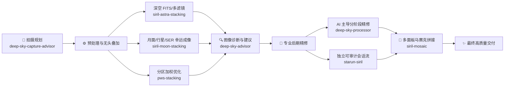

# deepsky-skill

[](https://skills.sh/MZqk/deepsky-skill)
[](https://github.com/MZqk/deepsky-skill/actions/workflows/skills-ci.yml)
[](#许可证--license)

**简体中文** | [English](README_en.md)

面向 Codex 与各类 AI Coding Agent 的专业天文摄影 Skill 集合，覆盖拍摄规划、器材选型、元数据推导、无头叠加、亚像素幸运成像、图像量化诊断、真实性约束下的后期处理、天文马赛克拼接，以及 PWS 分区加权叠加。

本仓库采用“领域单仓、独立发布单元”（Domain Monorepo with Independent Release Units）的组织方式：每个顶层 Skill 独立维护其依赖项、虚拟环境、自动化测试、语义版本、许可证和发布流水线；仓库根目录统一维护目录索引、结构与跨 Skill 契约校验、CI/CD 与轻量路由规范。

---

## 🌟 核心理念与架构原则

1. **AI 主导与严守真实性（AI-Directed under Authenticity Guardrails）**：AI 负责审美与处理策略决策，底层算法与门禁负责物理守恒。严禁伪造星点、人工硬化细节或非物理过饱和，全流程受量化保真门禁监控。
2. **完全无头化与自动化（Headless & Fully Scriptable）**：所有核心流水线均基于 CLI 或纯代码执行（如 Siril 1.4 CLI、PWS 无头引擎、Python 频域算法），无须人工打开图形界面，完美契合 AI Agent 自动化调用。
3. **分阶段可复现与可审计（Auditable & Reproducible Sessions）**：所有像素变换均保留原始参数、执行日志、差异比对面板和可重放脚本（如 Siril `.ssf`），支持断点续跑与历史复现。
4. **渐进式上下文加载（Progressive Context Disclosure）**：Skill 主文档 `SKILL.md` 仅包含核心规则与路由，专项知识下沉至 `references/`，避免长上下文污染与 Agent 认知超载。

---

## 🔭 天文全流程覆盖

从按下快门前到最终成片交付，8 个专业 Skill 紧密串联起完整天文工作流：



---

## Skills 一览

<!-- skills-index:start -->
| Skill | 用途 | 主要输出 |
| --- | --- | --- |
| [`deep-sky-capture-advisor`](deep-sky-capture-advisor/) | 使用内置可追溯知识快照回答深空摄影器材、拍摄、后期与排障问题 | 带适用条件、审核状态与来源路径的建议 |
| [`deep-sky-advisor`](deep-sky-advisor/) | 分析 FITS、XISF、TIFF、PNG 或 JPEG 深空图像，并给出有证据支持的后期建议 | 诊断数据、预览图、处理建议报告 |
| [`deep-sky-processor`](deep-sky-processor/) | 在真实性约束下，通过分阶段审查完成深空图像后期 | 自然版和增强版 JPG，可选 TIFF 母版 |
| [`pws-stacking`](pws-stacking/) | 无界面运行 PWS 分区加权叠加，开跑前强制预检已校准/已对齐前提 | 线性 Float32 XISF 成品、逐帧权重表与诊断场 |
| [`siril-astra-stacking`](siril-astra-stacking/) | 使用 Siril 1.4 CLI 叠加 FITS，支持多滤镜批处理与整桶续跑、外部 FITS/XISF 母版导入、六种通道合成及可选共同裁切与背景 MTF | 线性 Float32 FITS 或非线性 LRGB／HaLRGB、合成准备包、PNG 预览与覆盖及质量报告 |
| [`siril-manual`](siril-manual/) | 离线检索并读取经完整性校验的官方 Siril 1.4.4 纯文本手册语料与中英别名索引 | 精确命令语法、章节原文切片与 SHA-256 来源绑定查询结果 |
| [`siril-moon-stacking`](siril-moon-stacking/) | 融合 Siril 1.4.4 CLI 与亚像素频域配准，完成月面幸运成像堆叠与矿物月处理 | 32 位 FITS、TIFF 与高质量 JPG 成片 |
| [`siril-mosaic`](siril-mosaic/) | 使用 Siril 自动解算、配准并拼接已堆栈天文面板 | 线性 32-bit FITS、显示预览和审计记录 |
| [`starun-siril`](starun-siril/) | 以独立、可审计的 Siril CLI 会话处理已堆栈深空 master | 可审计的 .ssf 脚本与真实像素审查产物 |
<!-- skills-index:end -->

每个 Skill 的完整行为、约束和工作流均定义在对应目录的 `SKILL.md` 中。

---

## 目录结构

<!-- skills-tree:start -->
```text
.
├── deep-sky-capture-advisor/ # 自包含的深空摄影知识顾问
├── deep-sky-advisor/         # 深空图像诊断与后期建议
├── deep-sky-processor/       # AI 主导的深空图像处理工作流
├── pws-stacking/             # PWS 分区加权叠加（无界面，开跑前强制预检）
├── siril-astra-stacking/     # Siril 1.4 无头叠加流水线（按设备元数据推导参数）
├── siril-manual/             # Siril 1.4.4 离线手册检索与章节读取
├── siril-moon-stacking/      # 月面幸运成像堆叠与矿物月处理
├── siril-mosaic/             # Siril 天文马赛克拼接与视觉验收
└── starun-siril/             # 独立可审计的 Siril CLI 会话处理深空 master
```
<!-- skills-tree:end -->

各 Skill 按需包含 `scripts/`（执行入口）、`references/`（规范与算法契约）、`assets/`（预设与权重）、`tests/`（测试套件）和 `agents/openai.yaml`（Agent 元数据）。每个 Skill 独立维护其 `CHANGELOG.md`、许可证文件、`RELEASING.md` 和 `requirements-dev.txt`。

---

## 安装指南

### 方式一：使用 Skills CLI（推荐，支持主流 Agent 并触发 skills.sh 遥测收录）

本项目支持通过开放标准 Skills CLI 一键安装到 Claude Code、Cursor、Windsurf、Codex、Antigravity、OpenCode 等主流 Coding Agent。通过 `npx skills add` 安装会自动向 [skills.sh](https://skills.sh) 触发安装遥测，完成本仓库 Skill 的登记收录与热度更新：

```bash
# 安装整个仓库的所有 Skill 到当前项目 Agent
npx skills add MZqk/deepsky-skill

# 或指定安装特定 Skill（例如 deep-sky-processor）
npx skills add MZqk/deepsky-skill -s deep-sky-processor

# 全局安装到所有受支持的 Agent
npx skills add MZqk/deepsky-skill -g
```

> **遥测说明**：`npx skills add` 命令会向 `skills.sh` 遥测接口发送匿名安装事件（仅含 Skill 标识与时间戳，不包含任何隐私数据），使 Skill 自动进入 [skills.sh](https://skills.sh/MZqk/deepsky-skill) 目录与热度排行。若需关闭遥测，可设置环境变量 `DISABLE_TELEMETRY=1`。

### 方式二：手动软链接到 Codex Skills 目录

将需要的 Skill 目录软链接到 Agent 技能目录（以 Codex 为例）：

<!-- skills-install:start -->
```bash
CODEX_SKILLS_DIR="${CODEX_HOME:-$HOME/.codex}/skills"
mkdir -p "$CODEX_SKILLS_DIR"
ln -s "$(pwd)/deep-sky-capture-advisor" "$CODEX_SKILLS_DIR/deep-sky-capture-advisor"
ln -s "$(pwd)/deep-sky-advisor" "$CODEX_SKILLS_DIR/deep-sky-advisor"
ln -s "$(pwd)/deep-sky-processor" "$CODEX_SKILLS_DIR/deep-sky-processor"
ln -s "$(pwd)/pws-stacking" "$CODEX_SKILLS_DIR/pws-stacking"
ln -s "$(pwd)/siril-astra-stacking" "$CODEX_SKILLS_DIR/siril-astra-stacking"
ln -s "$(pwd)/siril-manual" "$CODEX_SKILLS_DIR/siril-manual"
ln -s "$(pwd)/siril-moon-stacking" "$CODEX_SKILLS_DIR/siril-moon-stacking"
ln -s "$(pwd)/siril-mosaic" "$CODEX_SKILLS_DIR/siril-mosaic"
ln -s "$(pwd)/starun-siril" "$CODEX_SKILLS_DIR/starun-siril"
```
<!-- skills-install:end -->

每个 Skill 拥有独立的 Python 虚拟环境，互相隔离、互不干扰。

---

## 使用示例

在 Agent 对话中可直接描述任务，或通过 `$skill-name` 显式调用：

<!-- skills-usage:start -->
```text
使用 $deep-sky-capture-advisor 根据我的器材和观测条件制定今晚的拍摄方案。

使用 $deep-sky-advisor 分析这张 FITS，并给出 PixInsight 后期建议。

使用 $deep-sky-processor 将这张星云图处理为自然版和增强版 JPG。

使用 $pws-stacking 对这组已校准已对齐的单通道帧做分区加权叠加。
使用 $siril-astra-stacking 将这批 Seestar 导出的 FITS 帧叠加成线性母版。

使用 $siril-manual 离线查询 Siril 1.4.4 中 SPCC 与 Richardson-Lucy 反卷积的精确命令参数。

使用 $siril-moon-stacking 对这组月面 RAW/SER 序列进行亚像素对齐与矿物月增强。

使用 $siril-mosaic 将这个目录中的已堆栈面板拼成完整天文马赛克。

使用 $starun-siril 在独立 Siril 会话中对已堆栈 deep-sky master 进行背景扣除与拉伸。
```
<!-- skills-usage:end -->

也可以从仓库根目录使用命令行直接驱动各 Skill 脚本：

```bash
# 知识查询
deep-sky-capture-advisor/.venv/bin/python -B \
  deep-sky-capture-advisor/scripts/query_knowledge.py \
  "城市阳台第一次拍摄" --format text

# 图像量化诊断
bash deep-sky-advisor/scripts/run_analysis.sh \
  /path/to/input.fits /path/to/output

# 深空后期处理流水线
deep-sky-processor/.venv/bin/python \
  deep-sky-processor/scripts/pipeline.py --help

# PWS 叠加预检
pws-stacking/.venv/bin/python \
  pws-stacking/scripts/precheck.py --frames-dir /path/to/frames

# 马赛克面板质检
siril-mosaic/.venv/bin/python \
  siril-mosaic/scripts/siril_mosaic.py inspect /path/to/panels
```

---

## 开发与验证

每个 Skill 均配有自包含的单元测试套件。进入各技能独立环境运行测试：

```bash
# 各技能独立单元测试
deep-sky-capture-advisor/.venv/bin/python -B -m pytest -p no:cacheprovider deep-sky-capture-advisor/tests
deep-sky-advisor/.venv/bin/python -B -m pytest -p no:cacheprovider deep-sky-advisor/tests
deep-sky-processor/.venv/bin/python -B -m pytest -p no:cacheprovider deep-sky-processor/tests
pws-stacking/.venv/bin/python -B -m pytest -p no:cacheprovider pws-stacking/tests
siril-astra-stacking/.venv/bin/python -B siril-astra-stacking/scripts/selftest.py
siril-moon-stacking/.venv/bin/python -B siril-moon-stacking/tests/test_runtime_safety.py
siril-mosaic/.venv/bin/python -B -m pytest -p no:cacheprovider siril-mosaic/tests
starun-siril/.venv/bin/python -B -m pytest -p no:cacheprovider starun-siril/tests
```

仓库根级契约校验（验证 README 规范、manifest 一致性及跨 Skill 引用合规）：

```bash
python3 scripts/validate_repository.py
python3 -m pytest -p no:cacheprovider tests
```

---

## 独立打包与发布

每个 Skill 均遵循独立语义化版本控制。发布步骤见各技能目录下的 `RELEASING.md`，变更记录见 `CHANGELOG.md`。

本仓库提供了统一的发布打包与检查脚本：

```bash
# 检查指定 Skill 的发布产物白名单与完整性
python3 scripts/release_skill.py --check siril-mosaic

# 打包指定 Skill 的独立发布 ZIP 包
python3 scripts/release_skill.py --package siril-mosaic --version 1.0.3 --output-dir dist/
```

> **注意**：严禁直接运行未经白名单过滤的目录发布命令（如 `skillhub publish`）。正式发布必须使用 `scripts/release_skill.py` 或对应 Skill 的 `package_release.py` 生成的严格白名单归档。

---

## 许可证 / License

本项目采用双重许可体系（Dual Licensing）：
- 仓库根层、治理脚本与专有封装遵循 **Proprietary License**（详见各技能目录下的 `LICENSE.md`）。
- 第三方组件与开源上游引擎（如 PWS 原生引擎、StarNet 等）严格遵循其原始开源协议（MIT / GPL-3.0，详见各技能目录下的 `THIRD_PARTY_NOTICES.md` 或 `scripts/vendor/LICENSE`）。
