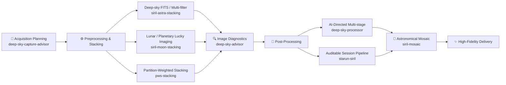

# deepsky-skill

[](https://skills.sh/MZqk/deepsky-skill)
[](https://github.com/MZqk/deepsky-skill/actions/workflows/skills-ci.yml)
[](#license)

[简体中文](README.md) | **English**

A professional astrophotography skill suite tailored for Codex and modern AI Coding Agents, covering acquisition planning, gear selection, metadata derivation, headless stacking, sub-pixel lucky imaging, quantitative image diagnostics, authenticity-constrained post-processing, celestial mosaics, and Partition-Weighted Stacking (PWS).

The repository follows a **Domain Monorepo with Independent Release Units** pattern: each top-level skill independently manages its dependencies, Python virtual environment, test suites, semantic versioning, licensing, and release workflow. The repository root strictly governs directory indexing, governance contracts, CI/CD, and lightweight routing conventions.

---

## 🌟 Core Philosophy & Architecture

1. **AI-Directed under Authenticity Guardrails**: The AI handles artistic judgment, parameter selection, and workflow steering, while physics conservation and quality gates strictly supervise pixel integrity. Hallucinating artificial stars, over-sharpening, or non-physical oversaturation is strictly rejected.
2. **Headless & Code-First**: All core pipelines operate via CLI tools and native Python code (Siril 1.4 CLI, headless PWS engine, sub-pixel FFT algorithms). No GUI interaction is required, making them ideal for autonomous AI agent execution.
3. **Auditable & Reproducible Sessions**: Every transformation preserves raw parameters, execution logs, difference panels, and replay scripts (such as Siril `.ssf`), allowing failure recovery and reproducible replays.
4. **Progressive Context Disclosure**: The primary `SKILL.md` file serves as a routing gateway with ironclad rules, while specialized domain specifications, mathematical formulas, and protocol details are organized into modular `references/` to prevent LLM context bloat.

---

## 🔭 End-to-End Astrophotography Pipeline

From pre-session planning to final high-resolution delivery, the 8 skills seamlessly connect the complete workflow:



---

## Skills Catalog

| Skill | Role & Capabilities | Primary Outputs |
| :--- | :--- | :--- |
| [`deep-sky-capture-advisor`](deep-sky-capture-advisor/) | Answers deep-sky gear, shooting, and troubleshooting queries using curated knowledge snapshots | Actionable recommendations with applicability conditions, audit status, and citations |
| [`deep-sky-advisor`](deep-sky-advisor/) | Inspects FITS/XISF/TIFF/PNG/JPEG deep-sky images and compiles evidence-based advice | Quantitative metrics, preview images, and dual-track processing reports |
| [`deep-sky-processor`](deep-sky-processor/) | Executes AI-directed deep-sky post-processing under strict authenticity guardrails | High-fidelity natural & enhanced JPGs, optional master TIFF |
| [`pws-stacking`](pws-stacking/) | Headless Partition-Weighted Stacking with mandatory fail-fast prerequisites precheck | Linear Float32 XISF master, frame weight matrices, and diagnostic fields |
| [`siril-astra-stacking`](siril-astra-stacking/) | Headless Siril 1.4 stacking with device detection, multi-filter batching, and channel composition | Linear Float32 FITS / nonlinear LRGB/HaLRGB, composition bundles, PNG previews, and reports |
| [`siril-manual`](siril-manual/) | Offline search and exact command/section reader for official Siril 1.4.4 documentation | Integrity-bound command usage, resolved RST sections, and bilingual search results |
| [`siril-moon-stacking`](siril-moon-stacking/) | Lunar lucky imaging with sub-pixel FFT registration, wavelet deconvolution, and mineral color | 32-bit FITS, TIFF, and high-quality natural/enhanced lunar JPGs |
| [`siril-mosaic`](siril-mosaic/) | Automated astronomical mosaic assembly via Siril WCS plate solving and reprojection | Linear 32-bit FITS mosaic, display previews, and audit logs |
| [`starun-siril`](starun-siril/) | Stage-by-stage (Stage 1–10) Siril CLI session processing for stacked deep-sky masters | Reproducible `.ssf` scripts and pixel verification panels |

Each skill's complete behavior, constraints, and workflow are specified in its corresponding `SKILL.md`.

---

## Directory Structure

```text
.
├── deep-sky-capture-advisor/ # Self-contained astrophotography knowledge advisor
├── deep-sky-advisor/         # Quantitative image diagnostics & dual-track advice
├── deep-sky-processor/       # AI-directed deep-sky post-processing workflow
├── pws-stacking/             # Headless Partition-Weighted Stacking (fail-fast prechecks)
├── siril-astra-stacking/     # Headless Siril 1.4 stacking pipeline (metadata-driven)
├── siril-manual/             # Integrity-verified Siril 1.4.4 offline manual search & reader
├── siril-moon-stacking/      # Lunar lucky imaging, wavelet sharpening & mineral moon
├── siril-mosaic/             # Siril astronomical mosaic solver & panel blender
└── starun-siril/             # Standalone auditable Siril CLI session processor
```

Each skill includes `scripts/` (execution entrypoints), `references/` (specifications & contracts), `assets/` (presets & weights), `tests/` (test suites), and `agents/openai.yaml` as needed. Each skill independently maintains its `CHANGELOG.md`, license, `RELEASING.md`, and `requirements-dev.txt`.

---

## Installation & Setup

### Method 1: Using Skills CLI (Recommended)

Compatible with Claude Code, Cursor, Windsurf, Codex, Antigravity, OpenCode, and any agent supporting open-standard skills:

```bash
# Install all skills into your current project agent
npx skills add MZqk/deepsky-skill

# Or install a specific skill (e.g., deep-sky-processor)
npx skills add MZqk/deepsky-skill -s deep-sky-processor

# Install globally for all supported agents
npx skills add MZqk/deepsky-skill -g
```

> **Telemetry Note**: The `npx skills add` command sends an anonymous installation event (skill identifier and timestamp only, no private data) to the `skills.sh` telemetry service to list the skill on the [skills.sh](https://skills.sh/MZqk/deepsky-skill) registry. To disable telemetry, set `DISABLE_TELEMETRY=1`.

### Method 2: Manual Symlink

Symlink individual skill directories into your agent's skill path (e.g. Codex):

```bash
CODEX_SKILLS_DIR="${CODEX_HOME:-$HOME/.codex}/skills"
mkdir -p "$CODEX_SKILLS_DIR"
for skill in deep-sky-capture-advisor deep-sky-advisor deep-sky-processor \
             pws-stacking siril-astra-stacking siril-manual siril-moon-stacking siril-mosaic starun-siril; do
  ln -s "$(pwd)/$skill" "$CODEX_SKILLS_DIR/$skill"
done
```

Each skill operates in an isolated Python virtual environment (`.venv/`).

---

## Quick Invocations

In your AI Agent chat, describe your goal directly or trigger a skill with `$skill-name`:

```text
Plan an imaging session tonight based on my equipment and sky conditions using $deep-sky-capture-advisor.

Analyze this FITS image and provide PixInsight post-processing advice using $deep-sky-advisor.

Process this emission nebula into natural and enhanced editions using $deep-sky-processor.

Perform partition-weighted stacking on these calibrated sub-frames using $pws-stacking.

Stack this batch of Seestar FITS frames into a linear master using $siril-astra-stacking.

Look up the exact Siril 1.4.4 CLI parameters for SPCC and Richardson-Lucy deconvolution offline using $siril-manual.

Align and sharpen this lunar SER sequence into a mineral moon portrait using $siril-moon-stacking.

Assemble this directory of stacked astronomical panels into a full mosaic using $siril-mosaic.

Execute background extraction and progressive stretch on this master using $starun-siril.
```

Or execute scripts directly from the command line:

```bash
# Knowledge query
deep-sky-capture-advisor/.venv/bin/python -B \
  deep-sky-capture-advisor/scripts/query_knowledge.py \
  "first time balcony imaging" --format text

# Quantitative image diagnostics
bash deep-sky-advisor/scripts/run_analysis.sh \
  /path/to/input.fits /path/to/output

# Deep-sky processing pipeline
deep-sky-processor/.venv/bin/python \
  deep-sky-processor/scripts/pipeline.py --help

# PWS stacking precheck
pws-stacking/.venv/bin/python \
  pws-stacking/scripts/precheck.py --frames-dir /path/to/frames

# Astronomical mosaic inspection
siril-mosaic/.venv/bin/python \
  siril-mosaic/scripts/siril_mosaic.py inspect /path/to/panels
```

---

## Verification & Testing

Each skill comes with a self-contained test suite. Run tests inside each skill's dedicated environment:

```bash
deep-sky-capture-advisor/.venv/bin/python -B -m pytest -p no:cacheprovider deep-sky-capture-advisor/tests
deep-sky-advisor/.venv/bin/python -B -m pytest -p no:cacheprovider deep-sky-advisor/tests
deep-sky-processor/.venv/bin/python -B -m pytest -p no:cacheprovider deep-sky-processor/tests
pws-stacking/.venv/bin/python -B -m pytest -p no:cacheprovider pws-stacking/tests
siril-astra-stacking/.venv/bin/python -B siril-astra-stacking/scripts/selftest.py
siril-moon-stacking/.venv/bin/python -B siril-moon-stacking/tests/test_runtime_safety.py
siril-mosaic/.venv/bin/python -B -m pytest -p no:cacheprovider siril-mosaic/tests
starun-siril/.venv/bin/python -B -m pytest -p no:cacheprovider starun-siril/tests
```

Validate repository structure, manifest consistency, and link reachability:

```bash
python3 scripts/validate_repository.py
python3 -m pytest -p no:cacheprovider tests
```

---

## Packaging & Releases

Each skill is versioned independently following semantic versioning. Refer to each skill's `RELEASING.md` and `CHANGELOG.md` for specific instructions.

To inspect or package a release using the repository release utility:

```bash
# Validate package file whitelist
python3 scripts/release_skill.py --check siril-mosaic

# Package release archive
python3 scripts/release_skill.py --package siril-mosaic --version 1.0.3 --output-dir dist/
```

> **Caution**: Publishing directly without whitelist filtering (e.g. `skillhub publish`) is prohibited. Formal releases must use the strict archives generated by `scripts/release_skill.py` or the corresponding `package_release.py`.

---

## License

This project adopts a dual-licensing structure:
- Repository root, governance tools, and proprietary skill wrappers are governed by the **Proprietary License** (see `LICENSE.md` in each skill directory).
- Third-party components and open-source upstream engines (such as the original PWS algorithm, StarNet, etc.) strictly adhere to their respective open-source licenses (MIT / GPL-3.0; see `THIRD_PARTY_NOTICES.md` or `scripts/vendor/LICENSE` in each skill).
